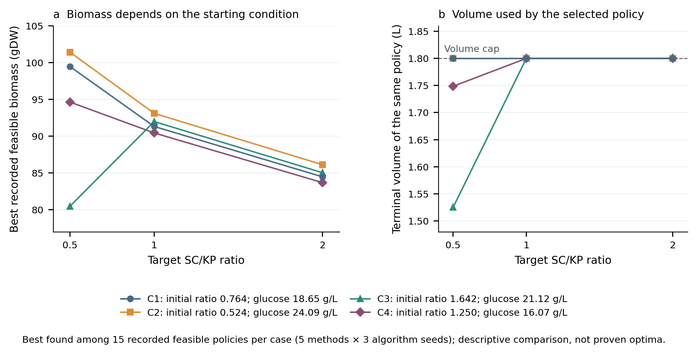

# Constrained biomass and composition control

This study designs the feed to a simulated *Saccharomyces cerevisiae*–*Komagataella phaffii* fed-batch culture. It maximises terminal biomass amount while meeting a prescribed species ratio and a reactor-volume cap. Direct single-start optimisation, three-start optimisation, a nearest-condition database, a quadratic surrogate and a neural surrogate are compared under the same mechanistic-evaluation budget. Surrogate and database proposals receive mechanistic correction before acceptance.

## Run the study

Install the repository's pinned requirements. From the repository root:

```sh
# Inspect data, predictions, control constraints, balances and result arithmetic.
python experiments/constrained_control/run.py verify

# Integrate every supplied policy again using the tighter ODE tolerances.
python experiments/constrained_control/run.py verify --integrate \
  --output local_verification/constrained_control.json

# Independently integrate biomass/substrate amounts, check glucose closure,
# and refine the three largest formulation discrepancies.
python experiments/constrained_control/run.py balance-check

# Specify a seven-interval feed policy; prints terminal state and constraints.
python experiments/constrained_control/run.py simulate \
  --feeds 0 0 0 0.1 0.1 0.1 0.1 --ratio 1 --glucose 20 --target 1

# Generate figures and numerical tables in a separate output directory.
python experiments/constrained_control/run.py figures \
  --output local_verification/control_figures

# Generate data, fit/select models, and execute all 180 optimisation runs.
# The output directory must not already exist.
python experiments/constrained_control/run.py study \
  --output local_verification/control_study_01
```

The full campaign took approximately 14 minutes in the recorded environment; actual times and optimiser paths can vary across systems. It refuses to replace an existing study directory. A 2400 s limit applies to the optimisation campaign, separately from data generation and subsequent sensitivity calculations. A partial campaign is identified explicitly and is not summarised as complete. Figure generation replaces files in its specified figure directory; it never modifies the supplied reference records.

The `direct` command runs the full intracellular solver without flux interpolation. First use `tools/prepare_inputs.py` to supply the four exact yeast model files listed in the repository input manifest. They are not distributed here.

```sh
python experiments/constrained_control/run.py direct --check-point 20 \
  --output local_verification/control_point.json
python experiments/constrained_control/run.py direct \
  --input experiments/constrained_control/reference/results/direct_input_mlp.json \
  --output local_verification/control_direct_mlp.json
```

The latter writes a result JSON and a companion trajectory CSV. A point check tests both intracellular models at one glucose concentration; it does not establish whole-trajectory accuracy.

## Model and units

The state ordering is `(V, X_SC, X_KP, S)`: volume in L, the two biomass concentrations in gDW/L, and glucose in g/L. The seven controls are feed rates in L/h, each held for 2 h over a 14 h horizon. The inlet contains 100 g/L glucose. For growth rates `mu_i` in 1/h and glucose exchange rates `v_g,i` in mmol/(gDW h),

```text
dV/dt   = F
dX_i/dt = (mu_i - F/V) X_i
dS/dt   = (F/V) (100 - S) + 0.18 sum_i(v_g,i X_i)
B_f     = V_f (X_SC,f + X_KP,f)
z_f     = ln(X_SC,f / X_KP,f)
```

The factor 0.18 converts mmol glucose to grams. Glucose uptake is negative in the exchange-flux convention. Intracellular rates use the monotone piecewise-cubic interpolants in `data/flux_table_eps1e-06.json`, at barrier and bound-relaxation parameters of `1e-6`. Below `1e-5 g/L` glucose, all interpolated rates are multiplied by `S/(1e-5 g/L)`; negative substrate is clamped to zero only when evaluating rates. This depleted-substrate convention is explicit in `scripts/simulator.py`.

Initial volume is 0.5 L and total biomass is 0.002 gDW/L. Initial species ratio ranges from 0.5 to 2 and glucose from 15 to 25 g/L. For ratio `r0`, the initial biomasses are `0.002 r0/(1+r0)` and `0.002/(1+r0)` gDW/L. The optimisation maximises `B_f`, with each feed between 0 and 0.2 L/h, terminal volume at most 1.8 L, and target ratio 0.5, 1 or 2. Optimisation uses a log-ratio margin of 0.009; final acceptance uses `abs(z_f - ln(r_target)) <= ln(1.01)` and volume slack `1e-8 L`. This symmetric multiplicative band is `[r_target/1.01, 1.01 r_target]`.

The mechanistic evaluator uses DOP853, `rtol=1e-7`, `atol=1e-9`, and maximum step 0.25 h. Selected controls receive a separate evaluation at `rtol=1e-9`, `atol=1e-11`. Each method has at most 300 distinct mechanistic attempts per case and seed; exact duplicate controls share a cache, and failures count against the budget. The three-start arm allocates 100 attempts per start. SLSQP uses `ftol=1e-8`, finite-difference step `1e-5` and at most 100 iterations. Selection first maximises biomass among evaluations meeting the tighter optimisation margin; acceptance-only or least-violation fallbacks are explicitly identified.

## Surrogate data and selection

The nine inputs are seven feed rates, log initial ratio and initial glucose. The outputs are log terminal ratio and log terminal biomass amount, with biomass numerically expressed relative to 1 gDW. Entire initial-condition groups are disjoint: 24 training conditions × 48 feeds = 1152 rows, 6 validation conditions × 32 feeds = 192 rows, and 4 test conditions × 64 feeds = 256 rows. Means and scales are fitted on training rows only. The validation score is mean squared error averaged over the two training-standardised outputs.

The quadratic model uses all degree-one and degree-two terms and Ridge penalties `1e-6`, `1e-3` and `1`. The neural model is a 9–15–2 network with logistic hidden units, linear outputs and L-BFGS training. Its initialisation seeds are 733, 734 and 735; regularisation is `1e-4`, tolerance `1e-7`, and maximum iterations 1500. Validation selects penalty `1e-6` and neural seed 733. All neural candidates reached the iteration limit; their warnings are retained in the selection record. Predictive performance and verified policy outcomes are reported rather than an unsupported convergence claim.

Feed-generation seeds are 2026102211–2026102213 for training, validation and test. Two-thirds of samples use rejection sampling of the feed cube under the volume constraint; one-third also scale down the total feed. Optimisation seeds are 3101–3103, applied to each of four unseen conditions and three targets. Five methods × four conditions × three targets × three seeds give 180 policy runs. The test responses are not used for model selection.

The released fitted predictors use JSON coefficients and standardisation values in `reference/results/locked_models.json`; loading them executes no serialised objects. Their predictions agree with all supplied held-out predictions to numerical precision. `scripts/surrogate_model.py` also exports newly fitted models in this format.

## Results and their scope



Terminal biomass amount and volume for the best recorded feasible policy in each of four initial conditions and three targets. Connecting lines guide the eye.


All 180 selected policies satisfy the tighter table-ODE acceptance checks. Neural prediction RMSE is 0.00752 in log ratio and 0.230 gDW in terminal biomass, compared with 0.0545 and 1.61 gDW for the quadratic model. This predictive advantage does not establish a complete-cost advantage: across 36 decisions per method, the measured totals including the specified development-label and fitting costs are approximately 160, 191, 173, 180 and 176 s for single start, multistart, database, quadratic and neural methods, respectively. Offline label generation and model selection are separated from online work; shared response-table construction is excluded equally. Test-label generation, sensitivity calculations and direct verification are separate research-validation costs. The database training-only alternative is also reported.

Two policies selected by the protocol before outcomes were known receive direct KKT trajectory checks: initial-condition group 1, target 1, seed 3101, for the multistart and neural methods. Their terminal biomass amounts are 91.3 and 91.2 gDW. Table/direct biomass differences are below 0.0003%. These checks share the intracellular equations and matrices but use independently coded amount balances. They verify two nondepleted trajectories, not all 180 policies or an independent biological model.

The seed-3101 controls are also evaluated at four combinations of ±5% changes in initial ratio and glucose. Only 9–11 of 48 perturbations per method stay in the nominal composition band. These are deterministic open-loop sensitivity calculations, not probabilities or feedback-control tests. Of the 180 nominal trajectories, 39 reach the low-glucose rate-scaling region; those target-2 cases remain conditional on that stated convention. The study establishes model-conditioned nominal performance in one model pair and four held-out condition groups. It does not establish global optimality, uncertain-condition robustness, experimental validity of the coculture, or a general neural speed-up.

## Files, sources and licence

- `scripts/`: simulation, optimisation/training, JSON predictors, direct KKT verification, aggregation and figure generation.
- `reference/data/`: three grouped datasets and two held-out prediction arrays.
- `reference/results/policies/`: all 180 controls, optimiser traces, final verification and costs, without performance-based omission.
- `reference/results/`: full-precision summaries, selection, sensitivity, direct trajectories and execution records.
- `reference/protocol*.json`: study design and amendments, with portable paths.
- `SOURCE_MANIFEST.json`: recorded source digests and corresponding released files; public packaging changes entry points, paths and serialisation, while preserving the numerical calculation.

The software accompanies Qianyue Zhang's thesis and builds on the interior-point dFBA formulation of Scott et al. (2018), DOI [10.1016/j.compchemeng.2018.08.041](https://doi.org/10.1016/j.compchemeng.2018.08.041), and the yeast benchmark described by Prakitr Srisuma (2018), as detailed in the root [study guide](../../docs/studies.md#benchmark-source). The paired yeast reconstructions and experimental publications require their own citations. No laboratory measurements are introduced by this extension.

Author-owned source, numerical results and documentation are covered by the repository's MIT Licence subject to its [terms](../../TERMS.md). Model reconstructions are separate inputs and are not relicensed or distributed. No manuscript, literature PDF, access credential, fitted pickle or installed dependency is included.

The independent amount-balance check integrates species masses and cumulative glucose consumption with analytic volume. Across all 180 policies it preserves feasibility, closes the glucose balance to within `4.0e-13 g`, and differs from the concentration formulation by at most `1.5e-7` in relative terminal biomass. A separate tolerance study checks the three largest log-ratio discrepancies; its final formulation differences are below `4.4e-8`. These numerical tolerances are retained explicitly rather than rounded into a claim of exact equality.
